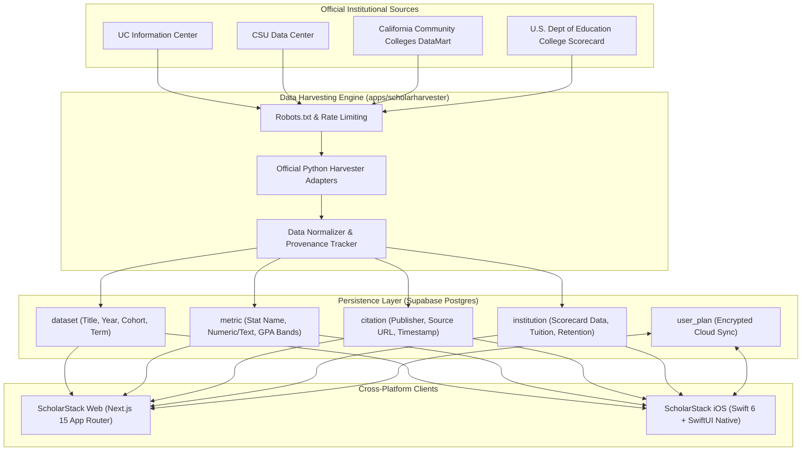

# ScholarStack Architecture & Engineering Standards

## 1. Executive Overview

**ScholarStack** is an open, evidence-grounded intelligence platform for higher-education transfer and admissions pathways. It delivers verifiable data on admit rates, 25th–75th percentile GPA thresholds, degree progress tracking, and portfolio risk analysis for California Community College (CCC) transfers and high school seniors applying to the University of California (UC), California State University (CSU), and independent institutions.

---

## 2. Monorepo Organization

The project is structured as an enterprise-grade monorepo containing three coordinated applications:

```
ScholarStack/
├── Makefile                          # Master cross-platform orchestration control plane
├── docker-compose.yml                # Local containerized Postgres & Redis environment
├── ARCHITECTURE.md                   # System architecture & engineering guidelines
├── README.md                         # Project documentation & quickstart
├── .github/workflows/
│   ├── ci.yml                        # Universal CI (Linux: Node + Python, macOS: Swift/Xcode)
│   └── harvest.yml                   # Automated data harvesting pipeline
├── apps/
│   ├── scholarpath/                  # [Web Client] Next.js 15 + React + Tailwind + Vitest
│   ├── scholarharvester/             # [Data Pipeline] Python 3.13 + Poetry + Pytest + Alembic
│   └── scholarstack-ios/             # [Mobile Client] Swift 6.0 + SwiftUI + Swift Charts
└── supabase/
    ├── schema.sql                    # Production Postgres schema with RLS and composite indexes
    └── institution_migration.sql     # Scorecard migration & table schemas
```

---

## 3. High-Level System Architecture



---

## 4. Subsystem Architectures

### 4.1 ScholarStack Web (`apps/scholarpath`)
- **Framework**: Next.js 15.5 with App Router (`app/` directory).
- **Rendering Model**:
  - Server-Side Rendering (SSR) and Server Components for initial payload speed, SEO metadata, and dynamic routing (`/colleges/[externalId]`).
  - Client Components (`"use client"`) for interactive interfaces: Pathway Planner, Portfolio Strategy Advisor, and Transcript Auditor.
- **Styling**: Tailwind CSS with CSS custom properties for platform theming.
- **Testing**:
  - **Unit Tests**: Vitest with `@testing-library/react` (22 tests verifying queries, rate limiters, transcript parser, and portfolio advisor).
  - **E2E Tests**: Playwright running cross-browser user flow tests.

### 4.2 ScholarStack iOS (`apps/scholarstack-ios`)
- **Language & Concurrency**: Swift 6.0 with strict concurrency checks enabled (`@MainActor`, `Sendable`, structured concurrency).
- **UI & State**: Modern SwiftUI with the Observation framework (`@Observable` macro), private `@State` ownership, and `@Bindable`.
- **Data Visualization**: Apple Swift Charts (`import Charts`) with accessibility-ready `BarMark` range charts visualizing middle 50% GPA thresholds.
- **Hardware Integration**: On-device OCR using Apple's Vision framework (`VNRecognizeTextRequest`) and PhotosUI for instant transcript extraction.
- **Packaging**: Self-contained `ScholarStack.xcodeproj` (Xcode 27) and `Package.swift` (SPM) with pre-bundled offline JSON catalogs.
- **Testing**: Modern Apple Swift Testing framework (`@Suite`, `@Test`, `#expect`).

### 4.3 ScholarHarvester (`apps/scholarharvester`)
- **Language**: Python 3.13 managed via Poetry.
- **Ethics & Compliance**: Strict `robots.txt` respect, user-agent identification, backoff rate limiters, and `DATA_PROVENANCE.md` tracking.
- **Adapters**: Modular scrapers with VCR cassettes to prevent brittle HTTP regressions.
- **Testing**: Pytest with `vcrpy` (16 test cases).

### 4.4 Supabase Postgres Database (`supabase/`)
- **Relational Model**: Strict foreign key constraints with cascade deletes.
- **Security**: Row Level Security (RLS) enabled on all tables: public read-only policies for public education metrics, service-role privileges for ingest pipelines.
- **Performance Indexing**:
  - `metric_composite_lookup_idx`: Compound index on `(campus, cohort, stat_name, year)`.
  - `institution_filter_idx`: Compound index on `(state, control, admission_rate)`.
  - `institution_name_idx`: Full-text search GIN index on `to_tsvector('english', name)`.

---

## 5. Domain Logic Specifications

### 5.1 Transcript Audit Engine
- **Cumulative GPA Calculation**: Evaluates course units, letter grades (`A+` through `F`), passing marks (`P`/`CR`), and unit weights.
- **60-Unit Milestone**: Tracks progress toward the 60 transferable semester units required for UC/CSU upper-division transfer standing.
- **UC 7-Course Pattern**:
  - 2 transferable English composition courses (e.g., ENGL 1A + ENGL 1B/1C/2).
  - 1 mathematical concepts and quantitative reasoning course (e.g., MATH 1A, STAT 10).
  - 4 breadth courses across at least 2 distinct academic areas: Arts & Humanities, Social Sciences, Physical & Biological Sciences.
- **CSU Golden Four**:
  - A1: Oral Communication
  - A2: Written Communication
  - A3: Critical Thinking
  - B4: Quantitative Reasoning

### 5.2 Portfolio Advisor & Chancing Engine
- **Tiers**:
  - **Guaranteed (TAG)**: Matches student GPA against UC Transfer Admission Guarantee minimums (UC Davis 3.2+, UC Irvine 3.4+, UCSB 3.4+, UCSC 3.0+, UCR 2.8+, UCM 2.8+) and excludes impacted non-TAG majors (e.g., Computer Science).
  - **Likely / Safety**: GPA $\ge$ 75th percentile and overall admit rate $\ge$ 45%.
  - **Target**: GPA within the middle 50% admit band (25th to 75th percentile).
  - **Reach**: GPA $<$ 25th percentile or ultra-selective flagship ($<$ 15% admit rate: UC Berkeley, UCLA, Stanford).
- **Portfolio Health Score (0–100)**: Evaluates balance distribution to protect students from all-reach rejections or under-diversified lists.

---

## 6. Unified Developer Workflow

All repository tasks can be executed from the root using `make`:

| Command | Action |
| :--- | :--- |
| `make test` | Runs tests across Web (Vitest), Python (Pytest), and iOS (Swift Testing) |
| `make lint` | Runs code linters: Next.js ESLint and Python Ruff |
| `make build` | Compiles Next.js production build and Xcode iOS Simulator app |
| `make dev` | Launches local Next.js web application on `http://localhost:3000` |
| `make up` | Starts local Docker Compose Postgres and Redis services |
| `make seed` | Applies database schema to local or remote Supabase instance |
| `make clean` | Cleans build caches across Next.js, Python, and Swift |
EOF
