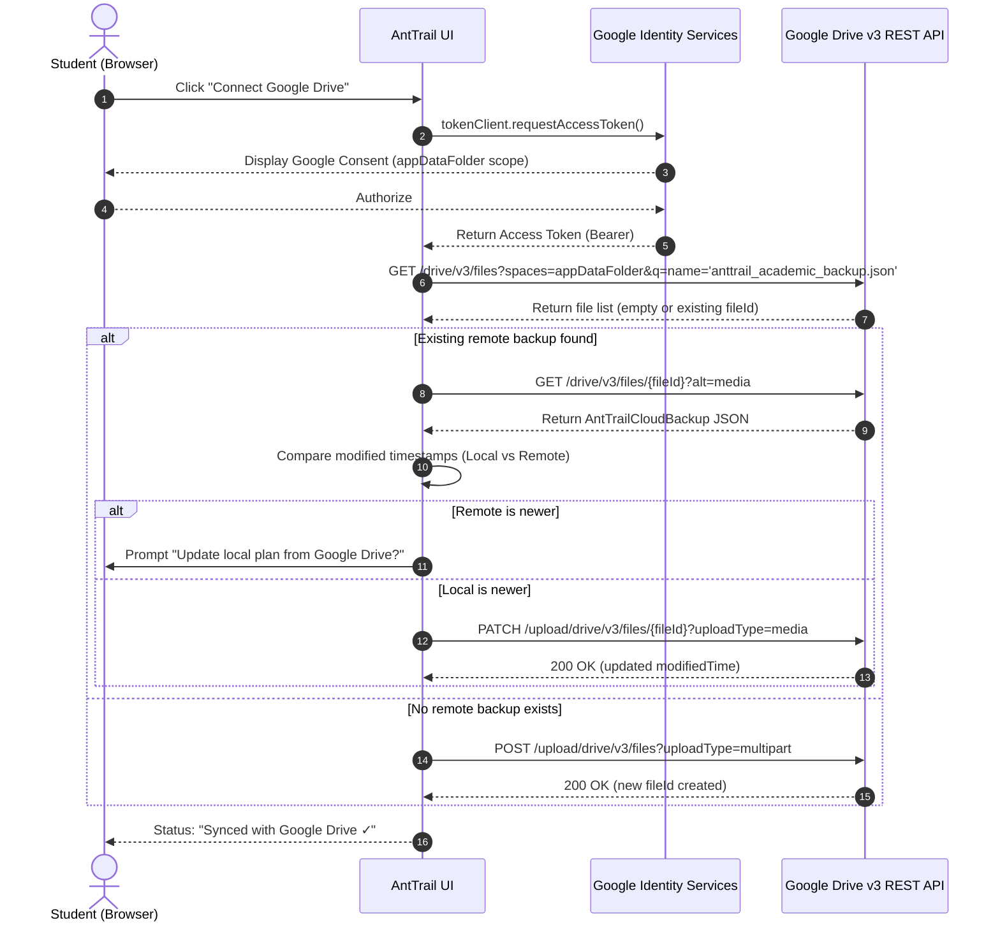

# AntTrail Phase 5 Design Specification: Google Authentication & Private Google Drive Sync

**Date:** 2026-10-01  
**Project:** AntTrail (`/Volumes/Crucial X9/AI/AntTrail`)  
**Scope:** Phase 5 (Client-Side Google OAuth 2.0, Private Google Drive `appDataFolder` Storage, Auto-Sync & Conflict Detection)  
**Status:** Approved for Implementation Planning  

---

## 1. Executive Summary & Problem Statement

UCI students create intricate, multi-year academic plans involving prerequisites, GE breadth categories, and quarterly offerings. To be truly useful across quarters, students need to access and edit their plans seamlessly across devices—from a laptop during academic advising in Donald Bren Hall to a desktop in their dorm or library.

However, traditional cloud-synced applications store user academic transcripts and schedules in a centralized backend database. This introduces substantial privacy and security liabilities:
- Centralized servers are targets for data breaches.
- Storing academic records triggers strict FERPA compliance concerns.
- Operating custom backend databases incurs recurring server costs and maintenance overhead.

**AntTrail's Solution:**  
Phase 5 implements a **100% serverless, client-side cloud backup and synchronization system** powered by Google Drive's restricted `appDataFolder` (`https://www.googleapis.com/auth/drive.appdata`). 
- AntTrail retains **zero servers, zero backend databases, and zero tracking**.
- The student's academic plan is stored in an encrypted, hidden application folder accessible exclusively by the student's own Google account.
- Direct browser-to-Google API calls preserve complete user ownership and zero 3rd-party data exposure.

---

## 2. Privacy & Security Invariants

1. **Zero Server Retention Invariant:**  
   There is no AntTrail backend server. API calls for authentication, token exchange, file creation, update, and retrieval occur entirely within the student's browser via direct HTTPS requests to `accounts.google.com` and `www.googleapis.com`.
2. **Least Privilege Invariant (`appDataFolder` Scope):**  
   AntTrail requests ONLY the `https://www.googleapis.com/auth/drive.appdata` scope (plus basic user identity for profile display: `openid`, `email`, `profile`). AntTrail **cannot** read, view, list, or edit any of the student's personal Google Drive files, Google Docs, photos, or emails.
3. **Hidden Application Sandbox Invariant:**  
   Files stored in `appDataFolder` are hidden from the standard Google Drive web interface. This prevents students from accidentally moving, renaming, or corrupting their academic backup file while organizing their coursework folders.
4. **Transient Token Invariant:**  
   Google OAuth 2.0 access tokens are maintained strictly in browser memory and discarded on tab close or sign-out. Tokens are never persisted to long-term unencrypted storage or transmitted anywhere else.
5. **Deterministic Serialization & Validation:**  
   Backup payloads contain full structural checksums and semantic versioning. Data loaded from Drive is validated against AntTrail's strict TypeScript schemas before merging into application state.

---

## 3. Architecture & Data Structures

### 3.1. Cloud Storage Payload Schema

The file stored in Google Drive is named `anttrail_academic_backup.json` in the `appDataFolder` space.

```typescript
export interface AntTrailBackupMetadata {
  version: 1
  exportedAt: string          // ISO timestamp
  appVersion: string          // e.g. "0.5.0"
  deviceLabel?: string        // e.g. "MacBook Pro - Chrome"
  checksum: string            // SHA-256 or fast hash of serialized plan data
}

export interface AntTrailCloudBackup {
  metadata: AntTrailBackupMetadata
  profile: StudentProfile
  quarterPlans: QuarterPlan[]
  selectedPersonaId: string
}
```

### 3.2. Sync Status & Provider State

```typescript
export type SyncStatus =
  | 'UNLINKED'       // Not signed in to Google
  | 'INITIALIZING'   // Loading Google Identity Services script
  | 'CONNECTING'     // In OAuth popup / authentication flow
  | 'IDLE'           // Authenticated and in sync
  | 'SYNCING'        // Uploading or downloading state
  | 'CONFLICT'       // Remote backup is newer than local state
  | 'ERROR'          // Network or authentication error
  | 'OFFLINE'        // Network unavailable

export interface DriveUserInfo {
  email: string
  name: string
  pictureUrl?: string
}

export interface DriveSyncState {
  status: SyncStatus
  userInfo: DriveUserInfo | null
  lastSyncedAt: number | null
  remoteFileId: string | null
  remoteModifiedTime: string | null
  autoSyncEnabled: boolean
  isMockMode: boolean
  errorMessage: string | null
}
```

### 3.3. Storage Provider Interface (`DriveStorageProvider`)

To ensure deterministic testing and allow offline demonstration without requiring immediate Google Cloud Console API credentials, AntTrail implements the **Provider Pattern**:

```typescript
export interface DriveStorageProvider {
  /** Initializes provider (loads scripts or mounts storage) */
  init(clientId?: string): Promise<boolean>
  
  /** Initiates OAuth flow or sets active session */
  signIn(): Promise<DriveUserInfo>
  
  /** Signs out and invalidates access tokens */
  signOut(): Promise<void>
  
  /** Retrieves currently active user session if valid */
  getCurrentUser(): Promise<DriveUserInfo | null>
  
  /** Fetches remote backup metadata and file ID if present */
  getRemoteMetadata(): Promise<{ fileId: string; modifiedTime: string; size: number } | null>
  
  /** Downloads the backup payload from appDataFolder */
  downloadBackup(fileId: string): Promise<AntTrailCloudBackup>
  
  /** Uploads (creates or updates) the backup file in appDataFolder */
  uploadBackup(backup: AntTrailCloudBackup, existingFileId?: string): Promise<{ fileId: string; modifiedTime: string }>
  
  /** Permanently deletes the backup file from appDataFolder */
  deleteBackup(fileId: string): Promise<void>
}
```

---

## 4. Google Drive REST API Interaction Flow



---

## 5. Conflict Resolution Strategy

When comparing local state and cloud backup:
1. **Identical Checksums:**  
   If the local state checksum matches the remote backup checksum, status is immediately `IDLE` (no sync needed).
2. **Local Modification Timestamp > Remote Timestamp:**  
   Local changes are newer. AntTrail safely uploads local state to Google Drive.
3. **Remote Timestamp > Local Modification Timestamp:**  
   Cloud backup is newer (e.g. edited on a different machine). Status transitions to `CONFLICT`.
   AntTrail displays a side-by-side reconciliation preview:
   - **Remote Details:** Timestamp, total completed courses, total planned quarters.
   - **Local Details:** Timestamp, total completed courses, total planned quarters.
   - **Options:**
     - `Use Cloud Plan`: Overwrites local state with Google Drive data.
     - `Overwrite Cloud`: Pushes local plan to Google Drive.
     - `Keep Independent`: Pauses sync until explicitly re-triggered.

---

## 6. UI & User Experience Components

1. **Navbar Cloud Status Indicator (`Navbar.tsx`):**
   - Compact pill in header next to "Zero Server Retention".
   - Shows connection icon (`CloudOff`, `CloudRain`, `CloudCheck`, `CloudAlert`, `RefreshCw` animated spin).
   - Shows active account email and sync time (e.g. `peter@uci.edu • Synced just now`).
   - Clicking opens the `GoogleDriveSyncModal`.
2. **Google Drive Sync Modal (`GoogleDriveSyncModal.tsx`):**
   - **Account Card:** User profile avatar, name, email, disconnect button.
   - **Sync Status & Actions:**
     - Big "Sync Now" button.
     - "Restore from Cloud" button.
     - "Auto-Save on Changes" toggle switch (debounced 3-second delay).
   - **Conflict Modal / Banner:** Clear side-by-side visual comparison when differences exist.
   - **Developer / Demo Mode Switch:**
     - One-click toggle between "Live Google API" and "Mock Provider (Offline Demo)".
     - Allows instant testing without needing a Google Cloud project or OAuth consent screen setup.
     - Custom Client ID field for students/developers running self-hosted builds.
   - **Privacy Explainer Box:**
     - Bullet points explaining that AntTrail has no server, uses only `appDataFolder`, and cannot access general files.

---

## 7. Verification & Testing Plan

1. **Vitest Unit Suite (`tests/drive-sync-engine.test.ts`):**
   - Backup payload serializer and checksum calculator.
   - Mock provider lifecycle: `signIn`, `uploadBackup`, `downloadBackup`, `getRemoteMetadata`, `deleteBackup`, `signOut`.
   - Timestamp and conflict comparison engine.
   - Schema validation rejecting corrupted or malformed payloads.
2. **Production Build:**
   - Full TypeScript verification (`tsc --noEmit`) and bundle build (`npm run build`).
